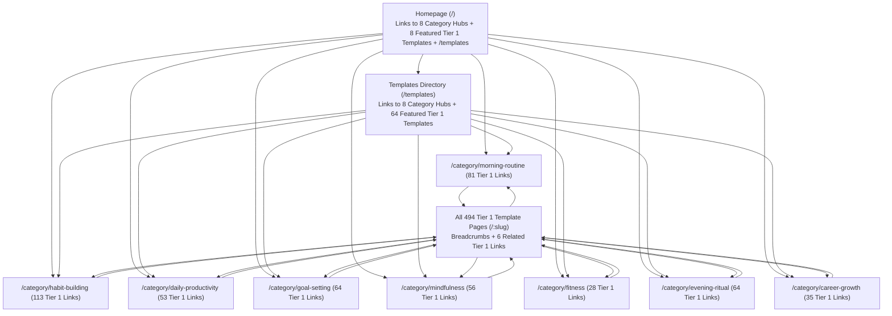

# Phase E & F — Sitemap & Crawl Discovery Strategy

**Project:** LifeHub (`https://life.freetoolshubs.com`)  

---

## 1. Sitemap Recovery Architecture (Phase E)

### Historical Defects Replaced
1. **Unfiltered 12,506-URL Sitemap:** Previously included all 12,500 uncurated template slugs (including 9,375 persona duplicates and 1,134 nonsensical cross-products) plus `/dashboard` (an empty client-side utility route).
2. **Uniform Artificial `<lastmod>` (`2026-04-17`):** `scripts/generate-sitemap.cjs` stamped `new Date().toISOString().split('T')[0]` across all 12,506 URLs whenever run, signaling artificial mass-modification to Google.
3. **Disconnected from Build:** `generate-sitemap` was not executed during `npm run build`.

### Remediated Sitemap Specification (`public/sitemap.xml` & `dist/sitemap.xml`)
- **Authoritative Generation:** Integrated directly into `npm run build` (`scripts/prerender.mjs`) and standalone `npm run generate-sitemap` (`scripts/generate-sitemap.cjs`), reading from the exact same Phase B classification rules (`src/utils/indexabilityPolicy.ts`).
- **Included URLs (`505` Total Canonical, Indexable URLs):**
  - `3` Core Static Indexable Routes:
    - `https://life.freetoolshubs.com/`
    - `https://life.freetoolshubs.com/templates`
    - `https://life.freetoolshubs.com/about`
  - `8` Category Directory Hub Routes:
    - `https://life.freetoolshubs.com/category/morning-routine`
    - `https://life.freetoolshubs.com/category/habit-building`
    - `https://life.freetoolshubs.com/category/daily-productivity`
    - `https://life.freetoolshubs.com/category/goal-setting`
    - `https://life.freetoolshubs.com/category/mindfulness`
    - `https://life.freetoolshubs.com/category/fitness`
    - `https://life.freetoolshubs.com/category/evening-ritual`
    - `https://life.freetoolshubs.com/category/career-growth`
  - `494` Tier 1 Strong Indexable Template Routes (`https://life.freetoolshubs.com/{slug}`)
- **Excluded URLs (`12,010` Routes Excluded from Sitemap):**
  - `/dashboard` (`noindex, nofollow` personal utility route)
  - `/privacy` and `/terms` (`noindex, follow` legal disclosures)
  - `/404.html` (`noindex, nofollow` error page)
  - `1,497` Tier 2 template routes (`noindex, follow`)
  - `9,375` Tier 3 persona variant routes (`noindex, follow`, canonicalized to Tier 1)
  - `1,134` Tier 4 mismatched cross-product routes (`noindex, follow`, canonicalized to Tier 1)
- **Omission of Unverified `<lastmod>`, `<changefreq>`, and `<priority>`:**
  - Because `public/lifeTemplates.json` does not store per-record content modification timestamps, `<lastmod>` is intentionally omitted rather than fabricating a uniform build date across all 505 URLs.
- **Scale & Protocol Limits:**
  - At `505` URLs (~39 KB XML file), `sitemap.xml` is well below the 50,000-URL / 50 MB single-sitemap protocol limit, avoiding unnecessary sitemap-index round-trips.

### Robots.txt Specification (`public/robots.txt`)
```text
User-agent: *
Allow: /
Sitemap: https://life.freetoolshubs.com/sitemap.xml
```
- Allows Googlebot full access to crawl all static assets, CSS/JS bundles, and HTML routes so that `<meta name="robots" content="noindex, follow" />` and `<link rel="canonical">` consolidations on Tier 2/3/4 pages can be seen and processed by Googlebot (never blocking `noindex` URLs via `Disallow`).

---

## 2. Internal Linking & Crawl Discovery Architecture (Phase F)

### Historical Discovery Bottleneck
Previously:
- `/` linked to only 6 templates (`lifeTemplates.slice(0, 6)`).
- `/templates` rendered only 50 templates (`filteredTemplates.slice(0, 50)`).
- `ToolPage.tsx` had **zero** outgoing links to related templates or category pages.
- **12,450 of 12,500 templates (99.6%) were completely unreachable via HTML `<a href>` links.**

### Remediated 3-Tier Pyramid Crawl Architecture



### Key Crawl Discovery Guarantees Verified by `scripts/validate-seo.cjs`
1. **Maximum Click Depth of 2 from Homepage:**
   - Click 0: `/` (Homepage)
   - Click 1: `/category/{category-slug}` (All 8 Category Hubs are linked directly in the Homepage body, Header/Footer navigation, `/templates`, and `/about`)
   - Click 2: Every single one of the **494 Tier 1 indexable template pages** is linked directly via semantic HTML `<a href="/{slug}">` inside its respective `/category/{category-slug}` page, grouped cleanly by scenario.
2. **Reasonable Link Density per Page:**
   - Each Category Hub page contains between **28 and 113 template links** (plus header/footer navigation), staying well below ~150 total links per page so link equity is not diluted.
3. **Contextual Cross-Linking & Breadcrumbs on Every Template Page (`ToolPage.tsx`):**
   - Every template page includes:
     - HTML Breadcrumbs (`Home > Templates > {Category} > {Template Title}`) with `BreadcrumbList` JSON-LD.
     - Up to **4 Related Templates in the Same Category/Scenario** + **2 Related Templates for the Same Audience (`{context}`) Across Other Categories**.
4. **Zero Internal Link Leakage to Excluded Tiers:**
   - All internal discovery modules (`Home.tsx`, `Templates.tsx`, `CategoryPage.tsx`, and `ToolPage.tsx` related links) filter strictly by `classifyTemplateRecord(t).tier === 'tier1'`, ensuring **0 internal links point to `noindex` Tier 2/3/4 pages**.

